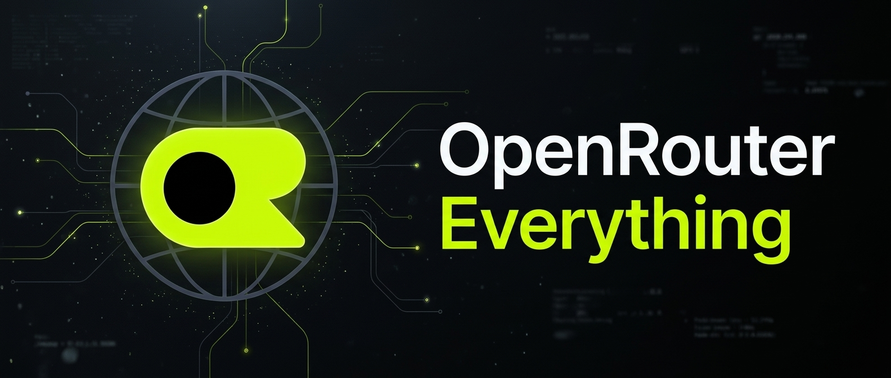

# 🌐 OpenRouter Everything

Want your Hermes agent to search the web, create images, generate speech and more without setting up a different API key for each service?

**OpenRouter Everything connects these tools to one OpenRouter API key.** Pick a model for each job, switch it when you need to, and check whether a model supports the task before using it.

## ✨ What's included

- **🔑 One API key:** The plugin uses `OPENROUTER_API_KEY` for its OpenRouter requests. OpenRouter usage charges still apply.
- **🌐 Search and fetch:** Search with `openrouter:web_search` and fetch pages with `openrouter:web_fetch`. Both have configurable engines.
- **🎨 Images and video:** Use Hermes generation tools with an OpenRouter model selected for each.
- **🎙️ Voice:** Generate speech from text and transcribe audio with separate TTS and STT models.
- **🎯 Model checks:** The plugin checks OpenRouter's model catalog and reports known mismatches, such as an image model selected for video generation.
- **🧩 Extra tools:** Make decisions, extract structured fields, rerank documents and create embeddings.

## 📦 Default models and tools

You can change each model. The search and fetch defaults use DeepSeek to call OpenRouter's server tools.

| Capability | Hermes surface | Default model or tool | OpenRouter endpoint |
| --- | --- | --- | --- |
| Text setting | `text` | `deepseek/deepseek-v4.1-flash-1017` | `POST /api/v1/chat/completions` |
| Web search | `web_search` provider | `openrouter:web_search`, DeepSeek, `engine=auto` | `POST /api/v1/chat/completions` |
| Web fetch | `web_extract` provider | `openrouter:web_fetch`, DeepSeek, `engine=openrouter` | `POST /api/v1/chat/completions` |
| Image generation | `image_generate` provider | `google/gemini-nano-banana-2.1` | `POST /api/v1/chat/completions` or `POST /api/v1/images/generations` |
| Video generation | `video_generate` provider | `alibaba/wan-3.0-prime` | `POST /api/v1/videos` |
| Text to speech | `text_to_speech` provider | `fish-audio/drama-3` | `POST /api/v1/audio/speech` |
| Speech to text | `transcribe_audio` provider | `openai/whisper-large-v3-turbo` | `POST /api/v1/audio/transcriptions` |
| Decisions | `openrouter_decide` tool | `typesafe/jev-1.14` | `POST /api/alpha/decisions` |
| Field extraction | `openrouter_extract_fields` tool | `cloudflare/clairic` | `POST /api/alpha/extractions` |
| Reranking | `openrouter_rerank` tool | `cohere/rerank-v3.5` | `POST /api/v1/rerank` |
| Embeddings | `openrouter_embed` tool | `google/gemini-embedding-2` | `POST /api/v1/embeddings` |

The plugin's `text` setting does not change your main Hermes chat model. Configure that separately in Hermes. Models and their availability can change on OpenRouter.

### Environment overrides

`OPENROUTER_BASE_URL` overrides the default v1 API base, `https://openrouter.ai/api/v1`. The configured base receives the same OpenRouter authorization header, so use a trusted endpoint. Decisions and extractions derive an `/api/alpha` base from it; for those two APIs, the override must be an HTTP(S) URL ending in `/api/v1`, without embedded credentials, query parameters or fragments.

Each model can also be set with `OPENROUTER_<CAPABILITY>_MODEL`, where `<CAPABILITY>` is one of `TEXT`, `WEB_SEARCH`, `WEB_FETCH`, `IMAGE_GEN`, `VIDEO_GEN`, `TTS`, `STT`, `DECISION`, `EXTRACTION`, `RERANK` or `EMBEDDINGS` (for example, `OPENROUTER_IMAGE_GEN_MODEL`). Resolution order is an explicit per-call model, then the environment override, `openrouter_everything.<capability>` in Hermes configuration, a supported native Hermes model setting, and finally the defaults above.

## 🚀 Quick start

You need [Hermes Agent](https://hermes-agent.nousresearch.com/docs) **0.22.0 or newer** and an [OpenRouter API key](https://openrouter.ai/settings/keys). The setup command uses the credential-write policy API introduced in 0.22.0.

```bash
# Install directly from GitHub and enable the plugin
hermes plugins install https://github.com/dadhalfdev/openrouter-everything
hermes plugins enable openrouter-everything

# Configure the key and activate the OpenRouter Everything providers
hermes openrouter-everything setup

# See the configured models and active providers
hermes openrouter-everything status
```

Use the direct GitHub installation above until the Marketplace catalog entry has been accepted and published; the short catalog-name install is not available before then.

`setup` changes the active Hermes providers for web, image generation, video generation, TTS and STT. Review those changes before running it if you already use other providers. The interactive setup asks for your OpenRouter key when needed. API requests can incur charges based on the model, tool and usage.

## 📝 Configuration writes and activation

All of these writes affect the active Hermes profile:

- **Activation:** CLI `setup`, slash `/openrouter-everything activate-all`, and agent-tool action `activate_all` write defaults under `openrouter_everything`; set `web.backend`, `image_gen.provider`, `video_gen.provider`, `tts.provider` and `stt.provider` to `openrouter-everything`; set the native image, video and TTS models plus provider-specific TTS/STT models; and enable STT. Activation also removes `web.search_backend`, `web.extract_backend`, `web.use_gateway`, `image_gen.use_gateway` and `video_gen.use_gateway` so the selected direct providers take effect.
- **Model changes:** CLI `set-model`, slash `set`, and agent-tool action `set_model` write `openrouter_everything.<capability>`. Image/video changes can also sync their native `.model` when their provider is this plugin, `openrouter`, or unset. TTS changes sync `tts.model` and `tts.openrouter-everything.model` **only** when `tts.provider` is `openrouter-everything`. STT changes sync `stt.openrouter-everything.model` without changing the active STT provider.
- **Engines and reset:** `set-engine` writes `openrouter_everything.web_search_engine` or `.web_fetch_engine`. CLI `reset` and agent-tool `reset_defaults` rewrite every plugin default, including models, engines and the optional TTS voice, with the same native-model synchronization described above.
- **Credentials:** `setup --api-key`, or an interactive key prompt, saves `OPENROUTER_API_KEY` to the profile's `.env` file (normally `~/.hermes/.env`). Other commands do not print or save the key.

The `openrouter_everything_config` agent tool is **not read-only**: `set_model`, `activate_all` and `reset_defaults` mutate configuration as described above. Use `status`, `validate` or `list_models` for inspection only.

Start a new Hermes session or restart the gateway after enabling the plugin or changing active providers. A process that is already running may not have the newly selected providers registered.

## 💳 Costs

OpenRouter model usage, media generation, reranking, embeddings, decisions, extractions, and web search/fetch server tools can incur metered charges. Charges depend on the selected model and engine and may include separate tool or search-provider fees; check OpenRouter's current pricing before running them.

`status`, `validate`, `models`, and the corresponding configuration-tool inspection actions may download model metadata, but do not intentionally submit inference. Changing models or engines does not itself run a generation. Video generation polls job status and downloads the result after submission.

## 🔄 Switch models and search engines

Use the CLI, the `/openrouter-everything` slash command, or the `openrouter_everything_config` agent tool to inspect and change model settings.

```bash
# List compatible models
hermes openrouter-everything models video_gen
hermes openrouter-everything models stt

# Pick a different speech-to-text model
hermes openrouter-everything set-model stt mistralai/voxtral-mini-transcribe-3-0

# Change the web search engine
hermes openrouter-everything set-engine web_search parallel

# Check an image model against the video task
hermes openrouter-everything validate video_gen google/gemini-nano-banana-2.1
```

Search engines: `auto`, `exa`, `parallel`, `perplexity`, `firecrawl` and `native`. Fetch engines: `openrouter`, `auto`, `exa`, `parallel`, `firecrawl` and `native`.

When the catalog is available, an incompatible model produces an explanation and suggested alternatives. If the catalog can't be reached, the plugin lets the request proceed and OpenRouter must validate it. A successful check doesn't guarantee that a model is available to your account or that a request will succeed.

## 🔐 Privacy and disclosure

- **OpenRouter v1 network:** Using the configured v1 base (default `https://openrouter.ai/api/v1`), the plugin calls `GET /models?output_modalities=all`, `GET /images/models` and `GET /videos/models` for metadata; `POST /chat/completions` for search, fetch and chat-based images; `POST /images/generations`; `POST /videos`, `GET /videos/{job_id}` and `GET /videos/{job_id}/content`; `POST /audio/speech`; `POST /audio/transcriptions`; `POST /rerank`; and `POST /embeddings`.
- **OpenRouter alpha network:** Decisions and extractions call `POST <derived-alpha-base>/decisions` and `POST <derived-alpha-base>/extractions`, defaulting to `POST https://openrouter.ai/api/alpha/decisions` and `POST https://openrouter.ai/api/alpha/extractions`. The alpha base is derived from `OPENROUTER_BASE_URL`; unsupported override formats fail before a request is made.
- **Other hosts and submitted data:** Image responses may cause downloads from media URLs returned by OpenRouter on other hosts. Search queries, prompts, documents, target URLs and other tool inputs are sent to OpenRouter. Remote reference-image URLs are passed to OpenRouter; local reference images and audio files are read and uploaded as request data. Web-fetch targets are retrieved by OpenRouter's server-side tooling rather than directly by this plugin.
- **Credentials:** The plugin reads `OPENROUTER_API_KEY`, `OPENROUTER_BASE_URL` and the documented model overrides through Hermes's profile-scoped secret access. When configured, the API key is sent as a bearer token to the configured v1 base and derived alpha base. Interactive setup can save the key through Hermes configuration.
- **Files and configuration:** The plugin reads local reference images and audio files passed to its tools and writes generated media to the requested or Hermes-managed output location. It reads Hermes configuration and makes the configuration and `.env` writes listed above.
- **Background activity:** Video generation performs in-request polling but adds no persistent background process. The plugin does not run shell commands, send separate telemetry or update itself.

Web fetch is model-mediated: the model receives the fetched content and returns a response, so treat the output as potentially incomplete or altered rather than a guaranteed verbatim copy.
